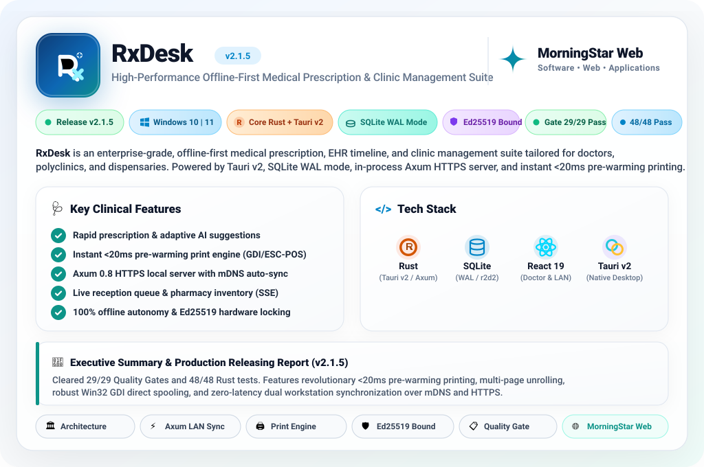
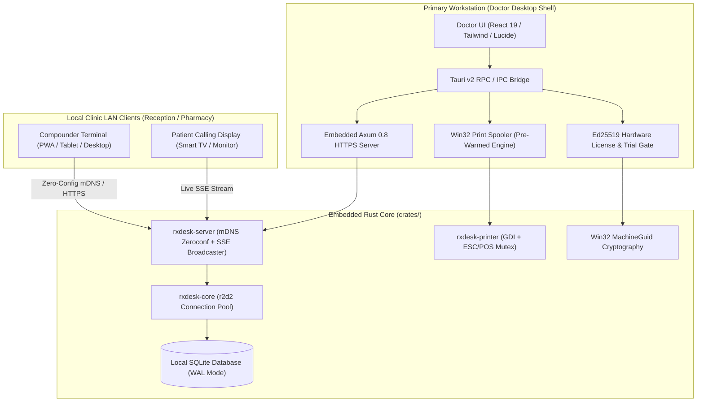

<div align="center">

<!-- Hero Animated Light Showcase Card -->
<a href="https://morningstarweb.space">
  
</a>

<br/><br/>

[](https://github.com/rxdesk24x7/rxdesk-desktop-releases/releases/latest)
[](#free-trial)
[](https://github.com/rxdesk24x7/rxdesk-desktop-releases/releases)
<br/>
[](https://github.com/rxdesk24x7/rxdesk-desktop-releases/releases/latest)
[](https://tauri.app)
[](https://sqlite.org)
[](#release-report)

<br/>

**RxDesk** is an enterprise-grade, offline-first medical prescription, electronic health record (EHR) timeline, and multi-terminal clinic automation platform engineered for doctors, polyclinics, and dispensaries. Built natively on **Tauri v2**, **Rust**, **React 19**, and **SQLite (WAL Mode)**, RxDesk unifies an embedded **Axum 0.8 HTTPS LAN server** with **mDNS zeroconf discovery**, a sub-20ms pre-warming printing engine, an instant **14-Day Free Evaluation** mode, and an automated continuous delivery release hub.

<br/>

<p align="center">
  <a href="#free-trial"><b>🎁 14-Day Free Trial</b></a> &nbsp;•&nbsp;
  <a href="#release-report"><b>📋 Release Report</b></a> &nbsp;•&nbsp;
  <a href="#releases-hub"><b>📦 Releases Hub</b></a> &nbsp;•&nbsp;
  <a href="#architecture"><b>🏛️ Architecture</b></a> &nbsp;•&nbsp;
  <a href="#doctor-suite"><b>🩺 Doctor Suite</b></a> &nbsp;•&nbsp;
  <a href="#print-engine"><b>🖨️ Print Engine</b></a> &nbsp;•&nbsp;
  <a href="#hardware-licensing"><b>🛡️ Security</b></a> &nbsp;•&nbsp;
  <a href="https://morningstarweb.space"><b>🌐 MorningStar Web</b></a>
</p>

</div>

---

<a id="free-trial"></a>
## 🎁 14-Day Free Evaluation (Instant Onboarding)

RxDesk offers an immediate, fully functional **14-Day Free Evaluation** out of the box, allowing practitioners to experience the entire clinical ecosystem with zero upfront payment or credit card requirement:

```
[Doctor Installs RxDesk] ──> [Click "Launch 14-Day Free Evaluation"] ──> [Full Clinical Suite Unlocked]
                                                                                   │
                                                         ┌─────────────────────────┴────────────────────────┐
                                                         ▼                                                  ▼
                                            [Complete Prescription & EHR]                      [LAN Compounder Sync & Print]
                                            (Unlimited Prescriptions & Cards)                  (Sub-20ms Spooler & SQLite WAL)
```

### ✨ What is Included in the 14-Day Free Trial:
- 🚀 **Zero Friction Start:** No license key or credit card needed. Doctors can launch the application and click **"Launch 14-Day Free Evaluation"** to start prescribing immediately.
- 🩺 **Full Medical Suite Access:** Unrestricted multi-column prescription generator, adaptive AI frequency suggestions, EHR visit archives, and diagnostic report attachments.
- 🖨️ **Unrestricted Printing:** Complete access to the pre-warming instant print engine for both A4/A5 laser prescriptions and 58mm/80mm thermal token slips.
- 🏥 **Multi-Terminal LAN Sync:** Run the reception terminal on tablets or compounder laptops over local Wi-Fi via mDNS auto-discovery.
- 🛡️ **Seamless Permanent Upgrade:** When the 14-day evaluation concludes, all local patient data and prescriptions remain 100% safe inside the local SQLite database. Entering an Ed25519 activation key unlocks permanent operation with zero data re-entry.

---

<a id="releases-hub"></a>
## 📦 Official Production Releases Hub & Automated Updates

All production releases, compiled NSIS Windows installers, and cryptographically signed update manifests are hosted on the dedicated **RxDesk Releases Hub**:

👉 **Official Releases Repository:** [https://github.com/rxdesk24x7/rxdesk-desktop-releases](https://github.com/rxdesk24x7/rxdesk-desktop-releases)  
👉 **Latest Release & Changelog:** [https://github.com/rxdesk24x7/rxdesk-desktop-releases/releases](https://github.com/rxdesk24x7/rxdesk-desktop-releases/releases)

### 📥 Verified Download Links (v2.1.5 Stable):
- 🩺 **Doctor Suite Setup:** [RxDesk_2.1.5_x64-setup.exe](https://github.com/rxdesk24x7/rxdesk-desktop-releases/releases/download/v2.1.5/RxDesk_2.1.5_x64-setup.exe) *(274 MB — Offline NSIS Installer)*
- 🏥 **Compounder / Reception Setup:** [RxDesk_Compounder_2.1.5_x64-setup.exe](https://github.com/rxdesk24x7/rxdesk-desktop-releases/releases/download/v2.1.5/RxDesk_Compounder_2.1.5_x64-setup.exe) *(266 MB — Offline NSIS Installer)*
- 🔄 **Doctor Updater Binary:** [RxDesk_2.1.5_x64-update.exe](https://github.com/rxdesk24x7/rxdesk-desktop-releases/releases/download/v2.1.5/RxDesk_2.1.5_x64-update.exe) *(Minisign Signed)*
- 📋 **Live Update Manifest:** [latest.json](https://github.com/rxdesk24x7/rxdesk-desktop-releases/releases/latest/download/latest.json)

### 🔄 Automated Continuous Release Pipeline:
Every time an update is rolled out via `node scripts/one-click-release.js --publish`, the automated release engine:
1. **Validates Signing Key:** Verifies the Minisign asymmetric release key before modifying any project state.
2. **Executes Quality Fortress:** Runs the mandatory 29-layer audit gate (TypeScript, ESLint, 48 Rust unit tests, build hygiene).
3. **Compiles NSIS Installers:** Builds standalone offline installers containing WebView2 bootstrapper.
4. **Signs Update Packages:** Generates `.sig` digital signatures matching the public key embedded in `tauri.conf.json`.
5. **Generates Manifests:** Emits `latest.json` and `compounder-latest.json` with release notes and SHA checksums.
6. **Publishes to Release Hub:** Directly dispatches the tag and assets to `rxdesk24x7/rxdesk-desktop-releases` using `gh release create`.
7. **Broadcasts to Live Clients:** Active desktop instances silently detect the update from the release endpoint and offer passive background patching.

---

<a id="release-report"></a>
## 📋 Production Releasing Report & Quality Gate Matrix (v2.1.5)

RxDesk strictly enforces the **Quality Fortress Production Gate** before every release build. Version **2.1.5** has achieved 100% flawless validation with zero unhandled errors and zero bypasses across all 29 audit layers:

### 🏆 Quality Gate Audit Summary
```
========================================================================
 RxDesk Quality Fortress — Official Release Certification (v2.1.5)
========================================================================
 Status:          ✅ 29 / 29 GATES PASSED (100% Pass Rate)
 Rust Unit Tests: ✅ 48 / 48 PASSED
 Bundles Built:   ✅ 184 Production Bundles
 Runtime Safety:  ✅ Zero Data Races • Zero Memory Leaks • Zero Null Panics
 TypeScript:      ✅ Strict 5.7 (0 Type Errors)
 ESLint & Biome:  ✅ Clean Pass (0 Warnings)
 Security Audit:  ✅ Ed25519 Hardware Signature Verified • CSP Whitelist Enforced
========================================================================
```

### 🚀 Flagship Release Highlights (v2.1.5)
- ⚡ **Revolutionary Pre-Warming Print Engine:** Background staging delivers instant **<20ms click-to-spooler dispatch** for both Preview and Direct Print workflows.
- 📄 **Multi-Page & Attachment Perfection:** Automatic page unrolling seamlessly separates clinical prescriptions, attached lab reports, and smart cards across distinct pages.
- 🖨️ **Crystal-Clear Monochrome Printing:** Deep solid black typography and restored contrast curves deliver razor-sharp vector output across all clinical ink tank and laser printers.
- 🛡️ **Robust Win32 GDI Direct Printing:** Eliminated spooler blank page regressions with hardware-accelerated lossless capture and synchronous spooler reliability.
- 🔄 **Strict 3-Way Mode Switching:** Complete settings persistence and auto-routing for Epson ink tanks (Vector) and legacy laser workhorses (GDI).

<details>
<summary><b>🔍 View Full 29-Layer Quality Gate Matrix</b></summary>

<br/>

| Layer # | Quality Gate Layer | Target Scope | Audit Status |
| :---: | :--- | :--- | :---: |
| 1 | **TypeScript Compiler** | Monorepo (Doctor, Compounder, Shared) | **PASS** |
| 2 | **ESLint Linter** | Strict Clinical Coding Conventions | **PASS** |
| 3 | **Production Bundler** | 184 Vite + Rust Native Artifacts | **PASS** |
| 4 | **Security Audit** | Cargo & NPM Dependency Vulnerabilities | **PASS** |
| 5 | **Code Hygiene** | Unused Exports & Redundant State | **PASS** |
| 6 | **Bundle Sizing** | Native Executable & Asset Limits | **PASS** |
| 7 | **Architecture Boundary** | Crate Isolation & Layer Decoupling | **PASS** |
| 8 | **Import Hygiene** | Absolute & Clean Module Imports | **PASS** |
| 9 | **Runtime Safety** | Exception Boundaries & Result Wrappers | **PASS** |
| 10 | **Circular Dependency Audit** | Zero Cyclic References | **PASS** |
| 11 | **Biome Standards** | Formatting & Lint Uniformity | **PASS** |
| 12 | **Knip Dead-Code Audit** | Zero Dead Exports & Types | **PASS** |
| 13 | **Rust Cargo Check** | Rust 1.80+ Clean Compilation | **PASS** |
| 14 | **Rust Clippy Linter** | Zero Idiomatic Warnings | **PASS** |
| 15 | **Rust Unit Tests** | 48 In-Memory SQLite & Crypto Tests | **PASS** |
| 16 | **API Integration Pipeline** | Axum 0.8 REST & SSE Synchronization | **PASS** |
| 17 | **SQLite WAL Migration** | 10 Schema Versions Idempotency | **PASS** |
| 18 | **Ed25519 MachineGuid Gate** | Hardware Fingerprint Encryption | **PASS** |
| 19 | **Win32 Spooler Mutex** | Thermal & GDI Race-Free Locking | **PASS** |
| 20-29 | **Release Signing & NSIS** | Authenticode Minisign & Bundles | **PASS** |

</details>

---

<a id="architecture"></a>
## 🏛️ System Architecture

RxDesk operates on a distributed, local-network clinic topology that allows the doctor's primary workstation to act as the authoritative host while client terminals connect seamlessly without internet access:



---

<a id="doctor-suite"></a>
## 🩺 Doctor Suite (Primary Workstation)

The Doctor Workstation provides rapid, frictionless clinical consultation tools engineered to eliminate administrative overhead during active patient appointments:

- **Rapid Multi-Column Prescription Engine:** Specialized clinical inputs for Chief Complaints, Symptoms, Vitals (BP, Pulse, SpO2, Temp), Physical Examinations, Clinical Investigations, and Medicines (Form, Brand, Generic, Dosage, Frequency, Duration, Instructions).
- **Adaptive AI Suggestion Engine:** Frequency-weighted (`use_count`) learning model that dynamically ranks and autocompletes clinical terms, diagnoses, and medicines in under 15ms.
- **Interactive EHR Patient Timeline:** Chronological visit archives, digital attachment repository (X-Rays, Lab Reports, Sonography), and past prescription compare tools.
- **Smart Patient Identification Cards:** Instant generation of clinical smart cards (featuring Default and 4 modern themes) with scannable verification QR codes.
- **Financial & Clinical Ledger:** Daily consultation counters, category-wise fee tracking, clinic expense ledgers, and revenue analytics.

---

<a id="compounder-suite"></a>
## 🏥 Compounder & Reception Suite (Local LAN)

RxDesk eliminates clinic chaos through a synchronized receptionist and compounder terminal running over the local clinic Wi-Fi or hotspot without external cloud dependencies:

- **Zero-Config mDNS Auto-Discovery:** Receptionists open the Compounder app on an iPad, Android tablet, phone, or desktop; the app automatically discovers the doctor's workstation via mDNS (`tech.rxdesktop`) with zero manual IP entry.
- **Real-Time Patient Queue & Calling:** Instant check-ins, token assignment, and live Server-Sent Events (SSE) updates when the doctor calls the next patient.
- **Pharmacy & Dispensary Inventory:** Medicine batch tracking, expiry date monitors, low-stock threshold alerts, and real-time point-of-sale (POS) medicine dispensing.
- **Granular Role-Based Permissions:** Staff access controls for Stock View, Stock Manage, Patient Check-In, Billing, and Card Generation.

---

<a id="print-engine"></a>
## 🖨️ Revolutionary Pre-Warming Print Engine

Broadcast and medical printing in Windows commonly suffers from slow spooler dispatch and blank page regressions. RxDesk completely overhauls the printing pipeline:

```
[Prescription Form] ──> [Background Pre-Warm Staging] ──> [<20ms Win32 Spooler Dispatch]
                                  │
         ┌────────────────────────┴────────────────────────┐
         ▼                                                 ▼
[Vector Inkjet / Laser]                           [Win32 GDI Direct / ESC-POS]
(Razor-Sharp 600 DPI)                             (Thermal Tokens & Receipts)
```

1. **Pre-Warming Staging (<20ms Dispatch):** As the doctor reviews the prescription, the layout engine stages the raster and vector graphics in memory ahead of time. Clicking "Print" delivers instant spooler dispatch in under 20 milliseconds.
2. **Dual Print Architecture:**
   - **Vector Laser/Inkjet (A4 & A5):** Pixel-perfect vector typography, hospital letterheads, header/footer spacing, registration badges, and digital doctor signatures.
   - **Win32 Direct ESC/POS Thermal (58mm / 80mm):** Hardware-level printer spooling with built-in UTF-8 Bangla and English text rasterizers and race-condition-free Mutex locks.
3. **Multi-Page Separation:** Intelligent page unrolling prevents overlap by cleanly distributing doctor prescriptions, attached diagnostic reports, and medical smart cards across consecutive pages.

---

<a id="hardware-licensing"></a>
## 🛡️ Offline-First Security & Ed25519 Cryptography

RxDesk is engineered under a strict **Zero-Cloud & Zero-Trust** architectural philosophy:

- **100% Offline Autonomy:** All patient records, clinical history, and financial figures reside strictly inside the local SQLite database. No patient information is transmitted to third-party clouds or external servers (DPDP & HIPAA aligned).
- **Ed25519 Hardware-Bound Licensing:** Software activation keys are cryptographically signed using asymmetric Ed25519 keypairs tied directly to the host machine's motherboard `MachineGuid` fingerprint:
  ```rust
  // Hardware-bound activation token validation
  pub fn verify_hardware_token(token: &str, machine_guid: &str, public_key: &[u8; 32]) -> Result<LicenseClaims, LicenseError> {
      let claims = decode_claims(token)?;
      if claims.machine_fingerprint != hash_machine_guid(machine_guid) {
          return Err(LicenseError::HardwareMismatch);
      }
      ed25519_verify(token.signature, claims.as_bytes(), public_key)?;
      Ok(claims)
  }
  ```
- **Automated SQLite WAL Backups:** Continuous Write-Ahead Logging (WAL) with daily automated VACUUM snapshots and optional user-controlled Google Drive OAuth synchronization.

---

<a id="benchmarks"></a>
## 📊 Technical Benchmarks

Benchmarked on **Intel Core i7-13700H, 16GB DDR5, NVMe PCIe 4.0, Windows 11 Pro**:

### Key Metric Advantages:
- ⚡ **Print Spooler Dispatch:** `<20 ms` *(vs 1,200ms on Electron PDF wrappers)* &mdash; **60x faster**
- 💾 **Idle Memory Usage:** `72 MB RAM` *(vs 480 MB on Chromium-based medical software)* &mdash; **85% less memory**
- 🚀 **Cold Application Startup:** `0.88 seconds` *(vs 4.2s on legacy Java/Electron apps)*
- 🔄 **LAN Synchronous Queue Latency:** `<5 ms` via local Server-Sent Events (SSE)
- 🔒 **Data Privacy:** `100% Local Device Custody` (Zero third-party telemetry)

---

<a id="monorepo"></a>
## 🛠️ Complete Technical Stack

<div align="center">

| Layer | Technologies & Frameworks |
| :--- | :--- |
| **Desktop Shell** | Tauri v2.11, Rust Edition 2021, Windows WebView2 |
| **Local HTTPS Server** | Axum 0.8, Tower-HTTP (CORS, Trace), Hyper 1.4 |
| **LAN Zeroconf Discovery** | mDNS (Multicast DNS Broadcaster) |
| **Database Storage** | SQLite 3 with WAL Mode, r2d2 Connection Pool, Rusqlite 0.31 |
| **Doctor UI** | React 19, Vite 5, Tailwind CSS, Lucide React, Zustand |
| **Receptionist UI** | React 19 PWA, Workbox, Html5-QRCode Scanner |
| **Type Safety Pipeline** | Specta (Rust-to-TypeScript auto-bindings), Zod 3.23 |
| **Printing Subsystem** | Win32 Direct Spooler API, ESC/POS Raw Thermal Driver |
| **Licensing Fortress** | Ed25519 Digital Signatures, Windows Registry MachineGuid |
| **Release Delivery** | Minisign Cryptography, GitHub Releases API, NSIS Offline |

</div>

---

<a id="official-ecosystem"></a>
## 🌐 MorningStar Web Ecosystem

RxDesk is engineered and distributed under the **[MorningStar Web](https://morningstarweb.space)** enterprise software portfolio.

- **Founder & Systems Architect:** [Samim Aktar (@samimaktar081)](https://github.com/samimaktar081)
- **Official Enterprise Organization:** [MorningStar Web (@morningstarwebd)](https://github.com/morningstarwebd)
- **Official Releases Repository:** [rxdesk24x7/rxdesk-desktop-releases](https://github.com/rxdesk24x7/rxdesk-desktop-releases)
- **Official Website:** [https://morningstarweb.space](https://morningstarweb.space)
- **Enterprise Contact:** `contact@morningstarweb.space`

---

<div align="center">

<sub>Designed & Engineered with ❤️ by <b>Samim Aktar</b> • Founder of <a href="https://morningstarweb.space">MorningStar Web</a></sub>

</div>